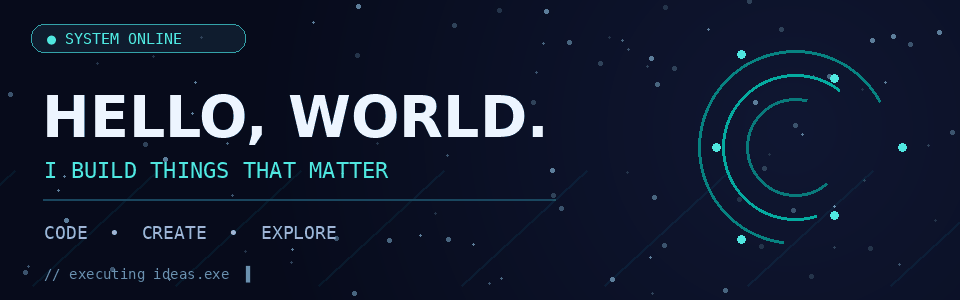
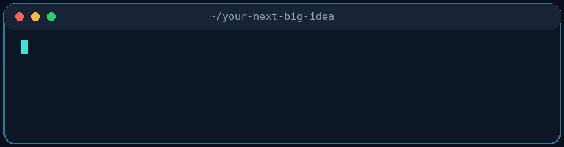

<!--
  COSMIC / DEVELOPER PROFILE — @itsDevlune
  GitHub profile repo: https://github.com/itsDevlune/itsDevlune
  Keep /assets and /.github/workflows intact.
  Optional Medium + Spotify integrations: see INTEGRATIONS.md.
-->

<div align="center">



<br />

<a href="https://github.com/itsDevlune"></a>
<a href="https://github.com/itsDevlune?tab=followers"></a>
<a href="https://github.com/itsDevlune"></a>

<br /><br />


**Developer by passion · Explorer by nature · Curious by default**

<sup>Writing code on a tiny planet in a very big universe.</sup>


</div>

<table width="100%">
<tr>
<td width="56%" valign="top">

### `> whoami` · About me

```yaml
handle: itsDevlune
identity: developer / curious mind
favorite_things:
  - programming & building
  - learning new technologies
  - astronomy & space
mission: turn curiosity into code
```

- 🧑‍💻 I enjoy **coding, programming and making ideas real**.
- 🌌 Fascinated by **space, science and the unknown**.
- 🐍 Building with **Python** and exploring the web with **JavaScript**.
- 🛰️ Always exploring, experimenting and improving.

</td>
<td width="44%" valign="top">

### `> ./launch.sh` · Live terminal



> *Code is the tool. Curiosity is the fuel.*

</td>
</tr>
</table>

<div align="center">


### ⚡ Tech stack · My developer toolkit

<sub>A selection from the technologies and tools in my stack</sub>

**Core languages**


<br />

**Web · Apps · UI**


<br />

**Data · Cloud · DevOps**


<br />

**Tools · Creative · Exploration**


<br /><br />


### 📊 GitHub · Mission control


<br />


<br /><br />

### 📈 Activity · The coding galaxy


<br />

### 🐍 Contribution snake · In orbit

<!-- Snake will render AFTER the 'Generate contribution snake' workflow publishes the output branch. -->

<picture>
  <source media="(prefers-color-scheme: dark)" srcset="https://raw.githubusercontent.com/itsDevlune/itsDevlune/output/github-contribution-grid-snake-dark.svg" />
  <source media="(prefers-color-scheme: light)" srcset="https://raw.githubusercontent.com/itsDevlune/itsDevlune/output/github-contribution-grid-snake.svg" />
  
</picture>

<br />

### 🪐 Developer timeline


<br />


<!--
  Medium and Spotify are READY TO ENABLE but require YOUR account IDs.
  Exact copy-paste blocks are in INTEGRATIONS.md.
  We don't render @undefined or a Spotify card without a user ID because they break.
-->

<br />

<div align="center">
  <h3>🪐 Discord • Live from Orbit</h3>

  <a href="https://discord.com/users/1352661689018880031">
    
  </a>
</div>

<div align="center">

### ⚡ Coding Activity | Mission Control

*Tracking my journey through code and the cosmos.*

</div>

<!--START_SECTION:waka-->

```txt
Total Time: 2 hrs 44 mins

Python       1 hr 14 mins          ██████████░░░░░░░░░░░░░░░   40.15 %
Markdown     52 mins               ███████░░░░░░░░░░░░░░░░░░   28.59 %
Other        20 mins               ██▓░░░░░░░░░░░░░░░░░░░░░░   10.97 %
JSON         15 mins               ██░░░░░░░░░░░░░░░░░░░░░░░   08.39 %
TOML         10 mins               █▒░░░░░░░░░░░░░░░░░░░░░░░   05.91 %
YAML         3 mins                ▒░░░░░░░░░░░░░░░░░░░░░░░░   01.81 %
Git Config   3 mins                ▒░░░░░░░░░░░░░░░░░░░░░░░░   01.81 %
Text         2 mins                ▒░░░░░░░░░░░░░░░░░░░░░░░░   01.49 %
```

<!--END_SECTION:waka-->


### 🌐 Contact · Open a channel

<a href="https://github.com/itsDevlune"></a>
<a href="https://x.com/itsdevluen"></a>
<a href="https://discord.com/users/itsdevlune">
  
</a>

<br /><br />


<sub>✦ THINK BEYOND · BUILD BEYOND · EXPLORE BEYOND ✦</sub>

</div>
